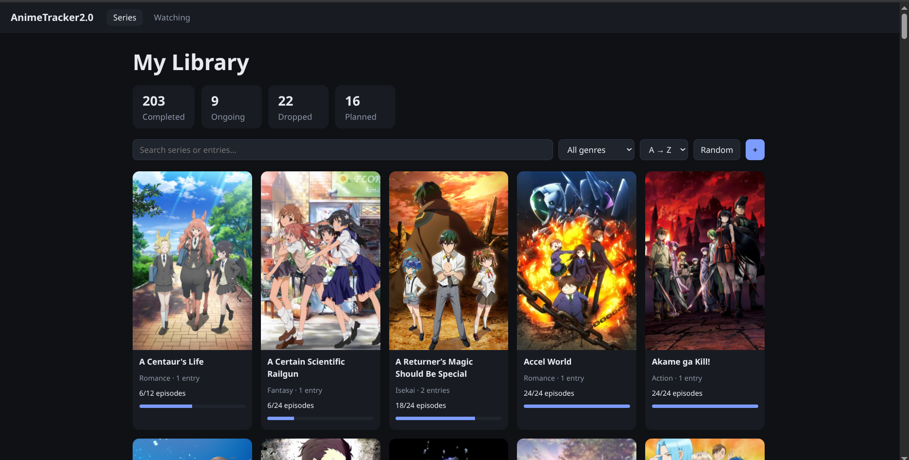
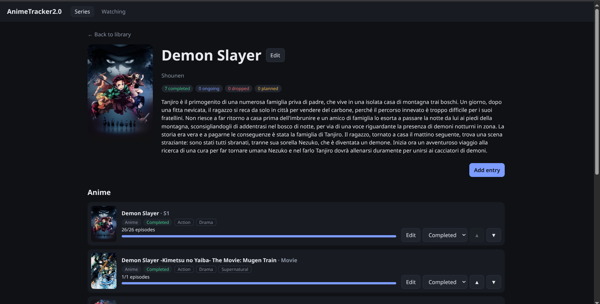
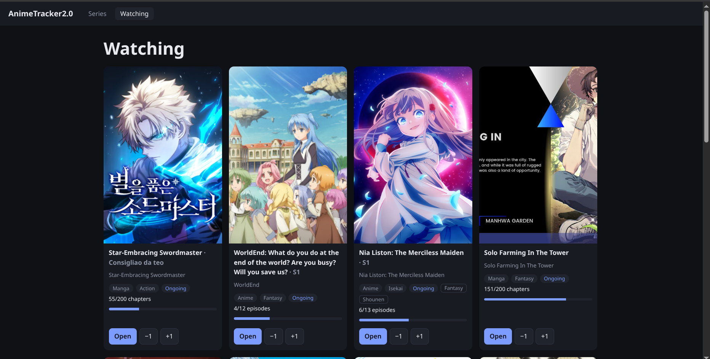

<div align="center">

# 🎌 AnimeTracker 2.0

**A self-hosted tracker for your anime and manga library.**
Keep every series, season, movie, OVA and volume in one place, and always know where you left off.


<!-- Add a hero screenshot or GIF here -->
<!--  -->

</div>

---

## 📖 About

AnimeTracker 2.0 is a small web app that runs on your own machine and keeps track of the anime and manga you are watching, reading, or planning to get to. Everything is stored locally in a single SQLite database, with no accounts, no cloud and no tracking.

Series are the main building block. Each series groups all of its related entries (seasons, movies, OVAs, manga, light novels), so a whole franchise lives in one place instead of being scattered across a flat list.

## 💡 Why I built it

<!-- TODO: fill in before the final version -->

---

## ✨ Features

- **Series and entries**: group seasons, films, OVAs, manga and light novels under a single series, with a custom order for each media group
- **Progress tracking**: keep count of watched episodes or read chapters, with a quick **+1** button; reaching the total completes the entry automatically
- **Statuses**: plan to watch, watching, completed and more, all governed by one consistent set of rules
- **Genres**: organize your library and find things quickly
- **Covers and notes**: upload cover images and write notes for each series
- **External links**: attach a link to an entry (streaming page, database entry, and so on)
- **Search and stats**: search across series names and entry titles, and see an overview of your library by status
- **Local-first**: one SQLite file and an `uploads/` folder, easy to back up

## 📸 Screenshots
| Home | Series detail | Watching |
| :---: | :---: | :---: |
|  |  |  |

---

## 🚀 Getting started

### Requirements
- [.NET 10 SDK](https://dotnet.microsoft.com/download)

That is all. There is nothing else to install.

### Installation
```bash
# 1. Clone the repository
git clone https://github.com/Matthew2077/AnimeTracker2.0.git
cd AnimeTracker2.0

# 2. Run the app
dotnet run --project src/AnimeTracker.Api --urls "http://0.0.0.0:5000"
```

Then open **http://localhost:5000** in your browser.

> **Note**
> Using `0.0.0.0` makes the app reachable from other devices on your local network (for example your phone) at `http://<your-computer-ip>:5000`. If you only want to use it on your own computer, replace it with `http://localhost:5000`.

### Running the tests

```bash
dotnet test
```

---

## 💾 Your data
AnimeTracker stores everything locally:

| What | Where |
| --- | --- |
| Database | `data/tracker.db` |
| Cover images | `uploads/` |

To **back up** your library, copy `tracker.db` and the `uploads/` folder. To **restore** it, put them back in the same place.

## 🧱 Tech stack
- **Backend:** ASP.NET Core (.NET 10) with Minimal APIs, grouped by endpoint set
- **Database:** SQLite through Entity Framework Core, with migrations
- **Frontend:** modular vanilla JavaScript served from `wwwroot/`
- **Tests:** xUnit, covering status rules, stats and ordering

## 📂 Project structure
```text
AnimeTracker2.0/
├── src/
│   ├── AnimeTracker.Api/        # Web API, services, data access and frontend (wwwroot)
│   └── AnimeTracker.Importer/   # One-off importer for data from the first version
├── tests/
│   └── AnimeTracker.Tests/      # xUnit tests
├── data/                        # SQLite database
└── uploads/                     # Cover images
```

## 📄 License
Distributed under the MIT License. See `LICENSE` for more information.

---

<div align="center">

Made by [Matthew](https://github.com/Matthew2077)

</div>
